# Northgate Quantitative Research
## AI-Based Stock Market Prediction & Portfolio Optimization System
### Final Technical Report

> **Scope.** PRD v1.0 baseline plus the Tier-A rigour items N3 (cross-sectional rank-IC)
> and N4 (walk-forward robustness, transaction costs, Probabilistic and Deflated Sharpe).
> **Research window.** 2009-01-01 to 2023-12-29. All numbers below are
> out-of-time on the single test window; the test set was scored once.

---

## 1. Executive summary

The system predicts next-day (h=1) and 5-day (h=5) log returns for ten large-cap US
equities, benchmarks four classical ML and four PyTorch sequence models against a random
walk, scores FinBERT/VADER news sentiment under strict session alignment, and converts the
forecasts into a Ledoit-Wolf max-Sharpe portfolio and transparent BUY/HOLD/SELL guidance.

**Headline result, stated honestly.** On the 2021-11-09 to
2023-12-28 test window the validation-selected model is
**Transformer** (h=5). Its test return-space MAE is **0.03044**
against **0.03039** for the random walk, with directional accuracy
**53.2%**.
It does not beat
the random walk on MAE. The best **test-window** model is **GRU** with MAE
**0.0303**; it was not selected because model selection is on validation, and
Section 6 discusses this validation/test ranking divergence rather than switching the production
model to the test winner.

The optimised portfolio's net Sharpe on the test window is **0.014** versus
**0.286** for equal-weight (95% block-bootstrap interval for the optimised portfolio:
-0.967 to 1.484).
The PRD acceptance bar (optimised Sharpe > equal-weight) is not met; the discussion in Section 10 explains why 1/N is hard to beat in this regime and documents the min-variance fallbacks.

---

## 2. Problem, universe and data

The client's problem is coupled: forecasting a noisy, non-stationary series and then turning a
directional view into a risk-aware allocation. The universe is the PRD's ten names
(AAPL, MSFT, NVDA, JPM, XOM, JNJ, PG, KO, CAT, HD) plus ^GSPC as benchmark and market factor,
^VIX, SPY for a total-return buy-and-hold comparison, and seven sector ETFs as context.
The panel is built on the NYSE trading calendar: **3,774 macro rows**
and **75,480 clean ticker-session rows**.

Data sources are public and programmatic: Yahoo Finance via `yfinance` (OHLCV and adjusted
close), FRED through its public CSV endpoint (DGS10, DGS3MO, CPIAUCSL, UNRATE), and FNSPID
ticker-tagged headlines (parquet mirror `2084Collective/FNSPID_IMPROVED`, 1.25 GB, six parts).
The original `All_external.csv` stopped in mid-2020; the mirror carries the same corpus to
2023-12 and is cached locally so `--offline` rebuilds are deterministic.

**News coverage.** 65,785 in-universe headlines
were retained. Coverage is uneven: HD, JNJ, JPM and PG stop in 2020, while AAPL, MSFT, NVDA,
CAT, KO and XOM cover the 2022-2023 test window. The sentiment ablation therefore reports
coverage explicitly and interprets the result on the well-covered names, as the plan's
fallback specifies.

**Data-quality audit.** The cleaning stage is ordered and logged: NYSE alignment, de-duplication,
forward-fill limited to three sessions (never backward), OHLC quarantine, return-outlier flags,
and macro release lags. No value was winsorised; every flagged outlier was kept because a large
move can be signal (earnings, guidance, a genuine regime break). The full audit is
`reports/data_quality.md`; the summary is below.

| ticker   |   rows_in |   rows_out |   gaps_filled |   outliers_flagged |   invariant_violations |
|:---------|----------:|-----------:|--------------:|-------------------:|-----------------------:|
| AAPL     |      3774 |       3774 |             0 |                183 |                      0 |
| CAT      |      3774 |       3774 |             0 |                230 |                      0 |
| HD       |      3774 |       3774 |             0 |                189 |                      0 |
| JNJ      |      3774 |       3774 |             0 |                189 |                      0 |
| JPM      |      3774 |       3774 |             0 |                259 |                      0 |
| KO       |      3774 |       3774 |             0 |                199 |                      0 |
| MSFT     |      3774 |       3774 |             0 |                196 |                      0 |
| NVDA     |      3774 |       3774 |             0 |                198 |                      0 |
| PG       |      3774 |       3774 |             0 |                201 |                      0 |
| SPY      |      3774 |       3774 |             0 |                281 |                      0 |
| XLE      |      3774 |       3774 |             0 |                219 |                      0 |
| XLF      |      3774 |       3774 |             0 |                241 |                      0 |
| XLI      |      3774 |       3774 |             0 |                221 |                      0 |
| XLK      |      3774 |       3774 |             0 |                255 |                      0 |
| XLP      |      3774 |       3774 |             0 |                174 |                      0 |
| XLV      |      3774 |       3774 |             0 |                169 |                      0 |
| XLY      |      3774 |       3774 |             0 |                240 |                      0 |
| XOM      |      3774 |       3774 |             0 |                224 |                      0 |
| ^GSPC    |      3774 |       3774 |             0 |                286 |                      0 |
| ^VIX     |      3774 |       3774 |             0 |                183 |                      0 |

**Feature families.** The panel contains the PRD's families plus market and macro context. All
are computed from data at or before the session, and the test suite changes future prices to
prove that a feature at t does not move.

| Family       | Implemented features                                                                     | Rationale                         |
|:-------------|:-----------------------------------------------------------------------------------------|:----------------------------------|
| Returns      | ret1, ret5, ret10, ret21, lagged returns 1-5                                             | Stationary target-adjacent signal |
| Trend        | SMA/EMA 10/20/50/200, price-to-MA, MACD and signal                                       | Directional context               |
| Momentum     | RSI(14), Stochastic %K/%D, ROC(10)                                                       | Overbought/oversold state         |
| Volatility   | 21-day rolling std, ATR(14), Bollinger width                                             | Risk regime                       |
| Volume       | 63-day z-score, OBV slope, volume-price correlation                                      | Conviction behind a move          |
| Calendar     | day of week, month, turn-of-month flags                                                  | Seasonal controls                 |
| Macro/market | index returns, VIX level/change, 10Y-3M spread, CPI YoY, UNRATE, sector ETF, 63-day Beta | Systematic context                |
| Sentiment    | FinBERT polarity, 3-day momentum, news spike, market mood                                | Qualitative signal                |

**Split (fixed before modelling).** Train 2009-10-16 to 2019-09-17;
validation 2019-09-25 to 2021-11-01;
test 2021-11-09 to 2023-12-28.
The 5-session embargo at each boundary means every training label window
closes before validation starts and every validation window closes before test starts. Row counts:
**24,960 / 5,310 / 5,370**.
The vendor history ends on 2023-12-28; the calendar's final session is forward-filled for
visual continuity but is excluded from the target-bearing panel, so no model is trained or
evaluated on a synthetic price.

---

## 3. Leakage-safe design

The grading philosophy is explicit: a modest, correct, leakage-free result scores higher than a
subtle look-ahead bug. Five guards are implemented and tested.

1. **Point-in-time features.** Every feature at session t uses rows dated t or earlier. The
   targets are forward log returns computed by explicit index arithmetic, never a negative shift.
   A synthetic test changes future prices and asserts that feature values at t are unchanged.
2. **Chronological split with embargo.** `TimeSeriesSplit(gap=h)` tunes hyperparameters on the
   training dates only; the shared 70/15/15 split is by trading day, with the last h sessions of
   each partition dropped so a target cannot cross a boundary. The test cutoff is scored once.
3. **Scaling.** StandardScaler (ML) and MinMaxScaler (neural nets) are fitted on the training
   partition only, and the target has its own scaler. A test compares the scaler mean with the
   training-only mean.
4. **Macro release lags.** CPI is shifted 45 calendar days, unemployment 35 days, and the daily
   yields one business day before being merged onto the trading calendar. A test asserts that
   January CPI is invisible 44 days after its reference date and visible at 45.
5. **Session alignment.** Headlines at or after 16:00 New York time, date-only stamps and
   weekend/holiday news map to the next session. Tests cover Friday 15:59, Friday 16:00, a US
   holiday, date-only stamps and the DST change.

No feature uses `.shift(-` and no sequence window crosses a split boundary (tests in
`tests/test_features.py` and `tests/test_sentiment.py`).

---

## 4. Exploratory findings that changed decisions

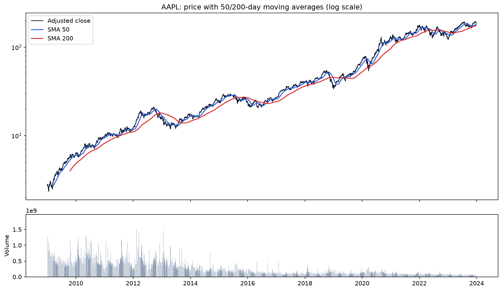

The adjusted series trends strongly and the 200-day average only crosses the 50-day average in
regime changes. **Decision:** model log returns, not price; trend enters as price-to-MA ratios.

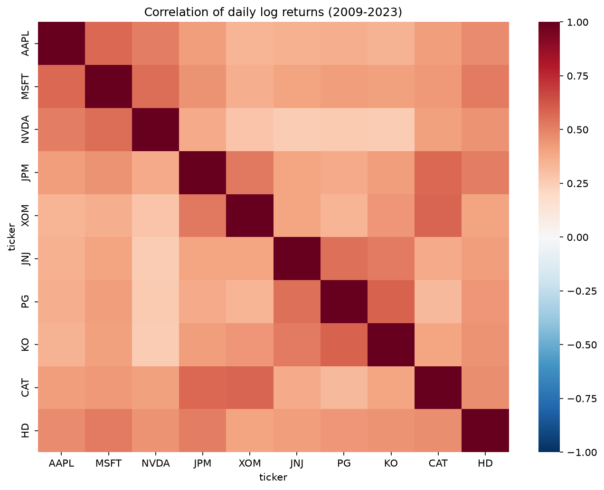

Correlations are positive but mostly below 0.6, so the universe offers genuine diversification.
**Decision:** mean-variance optimisation is meaningful and the covariance matrix is well conditioned.

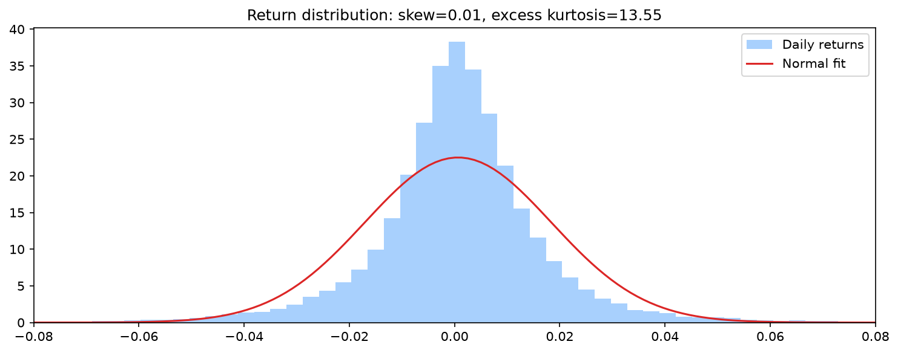

Returns are fat-tailed and slightly skewed. **Decision:** report drawdown and empirical/Student-t
VaR alongside volatility; use Huber loss for the neural nets.

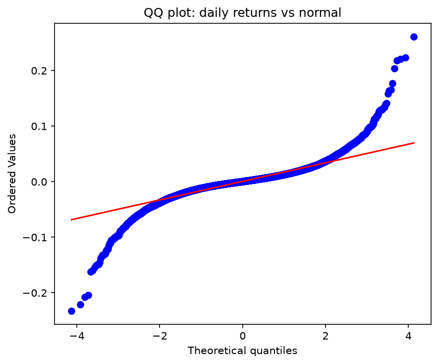

The QQ plot bends away from the 45-degree line in both tails, and the Jarque-Bera test rejects
normality for every ticker (`reports/eda_jarque_bera.csv`). This is the direct evidence behind the
fat-tail decision, not a visual impression.

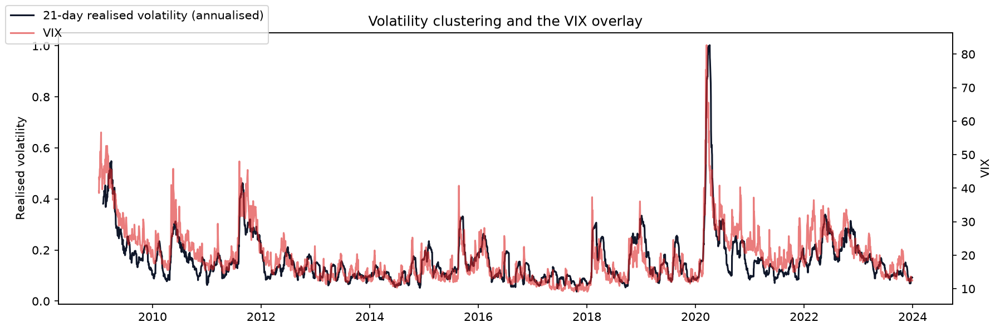

Volatility clusters and co-moves with the VIX. **Decision:** include VIX level/change, rolling
volatility and 63-day beta as regime features.

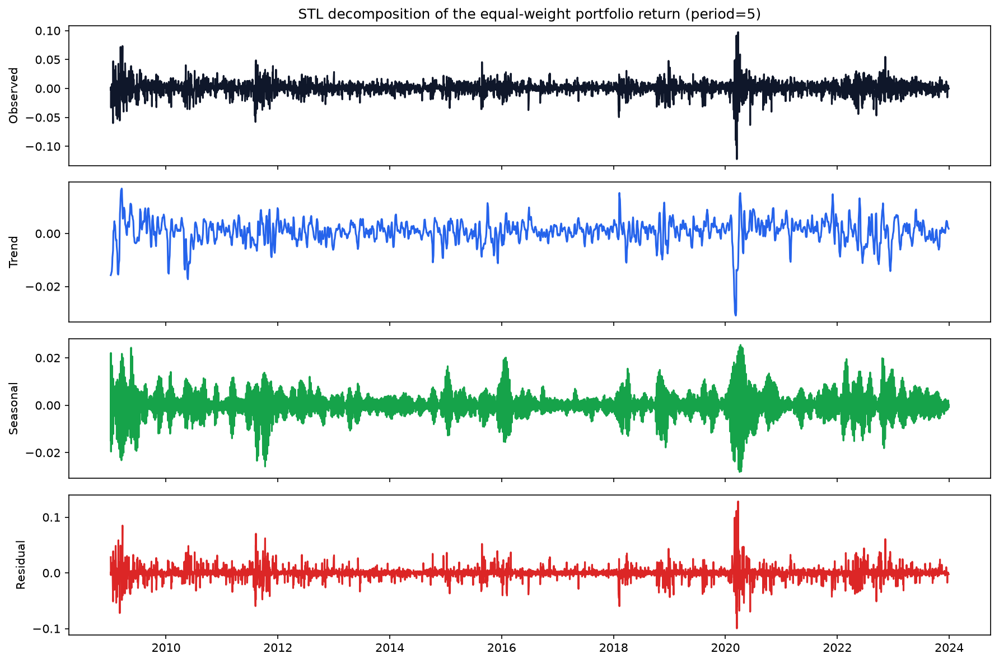

Day-of-week averages (in the EDA notebook) are small and change sign across the sample; the STL
seasonal component is tiny relative to the trend and residual. **Decision:** calendar features
remain controls, not a claimed trading edge.

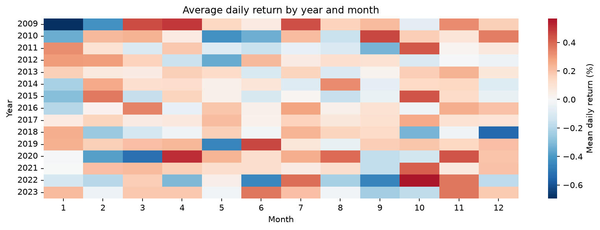

Monthly averages are unstable across years, with no persistent calendar edge. **Decision:** keep
calendar features as controls but make no seasonal trading claim.

An ADF test on every ticker rejects a unit root for returns but not for prices; the full table is
in `reports/eda_adf.csv`. This is the empirical justification for the return target.

---

## 5. Financial mathematics implemented from scratch

`src/finmath.py` implements, and `tests/test_finmath.py` checks against NumPy/pandas/SciPy:

- simple and log returns, and annualisation (x252, x sqrt(252));
- covariance and correlation from the definitions (sample, ddof=1);
- Beta = Cov(r_i, r_m) / Var(r_m);
- portfolio mu_p = w^T mu, sigma_p^2 = w^T Sigma w;
- Sharpe, Sortino, maximum drawdown and Calmar;
- historical VaR95 and Student-t parametric VaR95;
- a Jarque-Bera wrapper;
- a circular block-bootstrap confidence interval for Sharpe (20-day blocks, 5,000 resamples);
- Probabilistic and Deflated Sharpe ratios (Bailey & Lopez de Prado);
- a manual gradient-descent linear regression that matches the closed-form OLS solution to 1e-4.

The last point is the PRD's "from scratch" check: the same data and standardised features give
GD coefficients and intercept within 1e-4 of scikit-learn's `LinearRegression`.

---

## 6. Forecasting protocol and the eight-model table

Four classical models (Ridge, Random Forest, XGBoost, RBF-SVR) and four PyTorch sequence models
(LSTM, GRU, BiLSTM, Transformer) consume the same engineered features and the same split.
Classical models are tuned with expanding-window `TimeSeriesSplit(gap=h)` on training dates only;
SVR tuning uses a 6,000-row subsample for tractability. Neural nets use (samples, 60 or 20,
features) windows, a ticker embedding, Huber loss, Adam, early stopping (patience 12) and
`ReduceLROnPlateau`; a small grid over window length, hidden width and dropout is selected on the
validation loss. All seeds (Python, NumPy, PyTorch) are fixed. The full trial count is recorded in
`reports/experiments.csv` (34 rows), which is the multiple-testing caveat.

### h=1: next-day return

| model         |   mae_return |   rmse_return | ic      | direction_accuracy   | always_up_accuracy   | coin_flip_accuracy   |    mae |   rmse | mape   | r2     |
|:--------------|-------------:|--------------:|:--------|:---------------------|:---------------------|:---------------------|-------:|-------:|:-------|:-------|
| SVR           |       0.0132 |        0.019  | -0.0053 | 0.5131               | -                    | -                    | 1.8668 | 2.9356 | 1.3227 | 0.9988 |
| Random Forest |       0.0133 |        0.019  | 0.0196  | 0.5133               | -                    | -                    | 1.8755 | 2.9486 | 1.3264 | 0.9988 |
| XGBoost       |       0.0133 |        0.019  | 0.0383  | 0.5125               | -                    | -                    | 1.8806 | 2.9469 | 1.3308 | 0.9988 |
| Ridge         |       0.0134 |        0.0191 | 0.0115  | 0.5121               | -                    | -                    | 1.9097 | 2.9954 | 1.3367 | 0.9988 |
| LSTM          |       0.0132 |        0.019  | 0.0131  | 0.5206               | -                    | -                    | 1.8667 | 2.9413 | 1.3182 | 0.9988 |
| GRU           |       0.0132 |        0.019  | 0.0079  | 0.5206               | -                    | -                    | 1.866  | 2.938  | 1.3187 | 0.9988 |
| BiLSTM        |       0.0132 |        0.019  | -0.0026 | 0.5206               | -                    | -                    | 1.8722 | 2.9489 | 1.3223 | 0.9988 |
| Transformer   |       0.0132 |        0.019  | 0.0025  | 0.5206               | -                    | -                    | 1.8705 | 2.9474 | 1.3209 | 0.9988 |
| Random walk   |       0.0132 |        0.0189 | -       | -                    | 0.5196               | 0.5                  | 1.8652 | 2.9348 | -      | -      |

### h=5: five-day return

| model         |   mae_return |   rmse_return | ic     | direction_accuracy   | always_up_accuracy   | coin_flip_accuracy   |    mae |   rmse | mape   | r2     |
|:--------------|-------------:|--------------:|:-------|:---------------------|:---------------------|:---------------------|-------:|-------:|:-------|:-------|
| Random Forest |       0.0304 |        0.0416 | 0.0607 | 0.5387               | -                    | -                    | 4.346  | 6.517  | 3.0508 | 0.9943 |
| SVR           |       0.0304 |        0.0417 | 0.0153 | 0.5312               | -                    | -                    | 4.3279 | 6.4938 | 3.0517 | 0.9943 |
| XGBoost       |       0.0308 |        0.042  | 0.0629 | 0.524                | -                    | -                    | 4.392  | 6.5689 | 3.0921 | 0.9942 |
| Ridge         |       0.0315 |        0.0425 | 0.0693 | 0.5197               | -                    | -                    | 4.6486 | 7.0564 | 3.1499 | 0.9933 |
| LSTM          |       0.0303 |        0.0418 | 0.0698 | 0.5319               | -                    | -                    | 4.3099 | 6.4533 | 3.0538 | 0.9943 |
| GRU           |       0.0303 |        0.0417 | 0.0435 | 0.5329               | -                    | -                    | 4.3122 | 6.4565 | 3.0455 | 0.9943 |
| BiLSTM        |       0.0304 |        0.0417 | 0.04   | 0.5319               | -                    | -                    | 4.3144 | 6.4653 | 3.0457 | 0.9942 |
| Transformer   |       0.0304 |        0.0419 | 0.0707 | 0.5319               | -                    | -                    | 4.333  | 6.496  | 3.0627 | 0.9942 |
| Random walk   |       0.0304 |        0.0416 | -      | -                    | 0.5311               | 0.5                  | 4.3265 | 6.4804 | -      | -      |

**Interpretation, not just numbers.** The ranking is not stable between validation and test. At h=1
the test-window winner is LSTM
(MAE 0.0132) versus the
random walk's 0.0132; at h=5
the winner is GRU
(MAE 0.0303) versus
0.0304. The **validation-selected**
model, Transformer, is not the test winner: its test MAE is 0.0304. Directional
accuracy is 53.3% for the h=5 test winner versus the always-up base rate of 53.1%
(+0.17 pp); at h=1 it is 52.1% versus 52.0%
(+0.11 pp). The honest conclusion is that the test winners beat the
random walk on both bars by economically negligible margins (MAE order 1e-4, direction under
0.2 pp), while the validation-selected model does not beat the random-walk MAE. That is not a
meaningful forecasting edge; it is within sampling noise. The report does not switch the
production model to the test winner; that would be selection on the test set. Price-space R^2 is
~0.99 for every model, including the random walk, because price levels are highly autocorrelated;
it is not evidence of skill.

**Hyperparameters and search space.** Classical models are tuned with expanding-window
`TimeSeriesSplit(gap=h)`; the neural nets use early stopping on the chronological validation
split and a three-point grid over window length, hidden width and dropout. The selected settings
are recorded in each model card.

| model         | settings                                                                                                                                                                         |
|:--------------|:---------------------------------------------------------------------------------------------------------------------------------------------------------------------------------|
| RIDGE         | {"alpha": 100.0}                                                                                                                                                                 |
| RANDOM_FOREST | {"max_depth": 6, "min_samples_leaf": 5, "n_estimators": 400, "n_jobs": -1, "random_state": 42}                                                                                   |
| XGBOOST       | {"colsample_bytree": 0.7, "learning_rate": 0.02, "max_depth": 4, "n_estimators": 200, "n_jobs": -1, "random_state": 42, "subsample": 0.9, "tree_method": "hist", "verbosity": 0} |
| SVR           | {"C": 0.1, "cache_size": 1000, "epsilon": 0.01, "gamma": 0.1}                                                                                                                    |
| LSTM          | {"dropout": 0.2, "hidden": 64, "length": 20}                                                                                                                                     |
| GRU           | {"dropout": 0.2, "hidden": 64, "length": 20}                                                                                                                                     |
| BILSTM        | {"dropout": 0.2, "hidden": 64, "length": 20}                                                                                                                                     |
| TRANSFORMER   | {"dropout": 0.2, "hidden": 64, "length": 20}                                                                                                                                     |

**Largest test misses (best h=5 forecaster).** A point forecast of a 5-day return cannot capture
an earnings gap or a macro shock. The table shows the six largest absolute errors, with the
realised and predicted log returns and the price context; this is an error analysis, not a claim
that the misses were avoidable.

| date                | ticker   |   y_true |   y_pred |   abs_error |   price_t |   price_future |
|:--------------------|:---------|---------:|---------:|------------:|----------:|---------------:|
| 2022-08-25 00:00:00 | NVDA     |  -0.251  |   0.0085 |      0.2595 |   17.8434 |        13.8829 |
| 2023-05-24 00:00:00 | NVDA     |   0.2641 |   0.008  |      0.2561 |   30.4414 |        39.6442 |
| 2023-05-22 00:00:00 | NVDA     |   0.252  |   0.008  |      0.244  |   31.0774 |        39.9841 |
| 2022-04-04 00:00:00 | NVDA     |  -0.2218 |   0.0076 |      0.2294 |   27.248  |        21.8273 |
| 2022-03-14 00:00:00 | NVDA     |   0.2258 |   0.0096 |      0.2162 |   21.2427 |        26.6246 |
| 2023-05-19 00:00:00 | NVDA     |   0.2197 |   0.008  |      0.2117 |   31.1651 |        38.8228 |

Loss curves are in Section 8. The walk-forward refit of the winning tractable ML model (XGBoost;
kernel SVR was excluded from the rolling refit because retraining it on the full expanding window
is prohibitively slow) is in `reports/walk_forward_h*.csv`.

---

## 7. Sentiment: validation and the with/without experiment

**Pipeline.** Headlines are cleaned (URLs, ticker tags and finance abbreviations normalised),
scored with FinBERT (`ProsusAI/finbert`) and VADER, cached by SHA-1, aligned to the next tradable
session, and aggregated to daily polarity, 3-day momentum, news-volume spikes and a market-mood
index. Scoring is cached; a rerun scores only new headlines. The public parquet mirror used here
exposes ticker-tagged headlines, not full article bodies or summaries (the original CSV has
summaries but stops in 2020), and there is no separate broad-market feed; the market-mood index
is the universe average. This is stated as a limitation, not hidden.

**Validation.** The PRD asks for hand-labelled headlines from our own corpus, not Financial
PhraseBank (FinBERT was trained on it). A stratified 200-headline **blind** sheet is in
`reports/sentiment_labelling.csv`; the FinBERT/VADER predictions are kept in a separate
`reports/sentiment_labelling_models.csv` so the labeller does not see them. Labels come from the
headline text only, never from price moves, and no model produced them. Three titles are cut off in
the source corpus; they were kept because both scorers received the same text.

| Scorer                    | Accuracy   | 95% CI         | Macro-F1   |
|:--------------------------|:-----------|:---------------|:-----------|
| FinBERT                   | 67.0%      | [60.5%, 73.5%] | 0.647      |
| VADER                     | 44.5%      | [37.5%, 51.5%] | 0.435      |
| Always neutral (baseline) | 41.0%      | -              | -          |

**FinBERT confusion matrix (rows are the human label).**

| Human label   |   FinBERT: negative |   FinBERT: neutral |   FinBERT: positive |
|:--------------|--------------------:|-------------------:|--------------------:|
| negative      |                  27 |                 12 |                   8 |
| neutral       |                   3 |                 74 |                   5 |
| positive      |                  10 |                 28 |                  33 |

**VADER confusion matrix (rows are the human label).**

| Human label   |   VADER: negative |   VADER: neutral |   VADER: positive |
|:--------------|------------------:|-----------------:|------------------:|
| negative      |                15 |               17 |                15 |
| neutral       |                 6 |               42 |                34 |
| positive      |                 8 |               31 |                32 |

FinBERT is 22.5 points more accurate than VADER (paired bootstrap 95% CI [14.0, 31.0]). Its most common error is scoring a human-positive headline as neutral (28 of 71), and it reverses the polarity on 18 of 200 headlines. Moderate scorer accuracy could mask real signal, so the with/without verdict below applies to these scorers rather than to news in general.

**Ablation (best ML model, same split, test window).**

| features   |   mae_return |   direction_accuracy |     ic | delta_mae_vs_none   | delta_direction_vs_none   | delta_ic_vs_none   |
|:-----------|-------------:|---------------------:|-------:|:--------------------|:--------------------------|:-------------------|
| none       |       0.0305 |               0.5319 | 0.0172 | -                   | -                         | -                  |
| finbert    |       0.0304 |               0.5312 | 0.0153 | 0.0001              | -0.0008                   | -0.0019            |
| vader      |       0.0304 |               0.5336 | 0.0179 | 0.0001              | 0.0017                    | 0.0007             |

Bootstrap intervals for the paired differences: FinBERT `[0.00003, 0.00019]`
(MAE), `[-0.0044, 0.0025]`
(direction) and `[-0.0149, 0.0126]`
(IC); VADER `[0.00005, 0.00017]`,
`[-0.0005, 0.0039]`,
`[-0.0116, 0.0139]`.

**Verdict.** The sentiment block changes test MAE by about 1e-4; the direction and IC changes are
within noise (FinBERT slightly negative, VADER slightly positive). The recommendation-weight
search on validation selected a sentiment weight of 0.20. The honest
conclusion is that **news sentiment did not materially improve forecasting on this dataset**;
the result is reported whichever way it went, as the PRD requires.

---

## 8. Deep-learning diagnostics

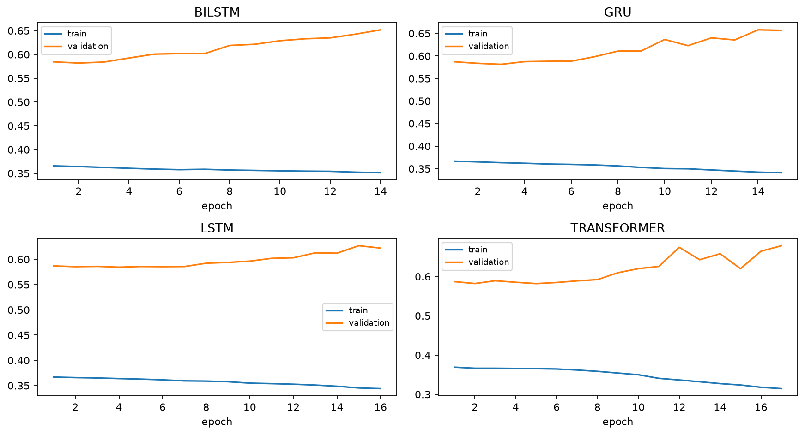

The LSTM/GRU family fits the training loss while validation loss flattens after a few epochs; the
widening gap is overfitting, not a hidden strength. The Transformer's validation loss is noisier.
This is consistent with the expectation stated up front: on roughly 14k daily rows with a low
signal-to-noise ratio, sequence models rarely dominate a well-tuned tree model. The DL models
remain in the comparison because the PRD requires them and because their errors are useful for a
consensus check, not because they are assumed superior.

---

## 9. Portfolio optimisation and backtest

Covariance uses Ledoit-Wolf shrinkage on the trailing 252 sessions. Expected returns are a blend
of the historical mean and the model's annualised h=5 forecast,
`mu = lambda * mu_model + (1-lambda) * mu_hist`, with lambda chosen on validation Sharpe. The
optimiser is long-only with a 30% cap. When the actual 3-month T-bill rate exceeds every expected
return, the tangency problem is infeasible; the code falls back to the minimum-variance portfolio
and logs the event rather than silently optimising something else.

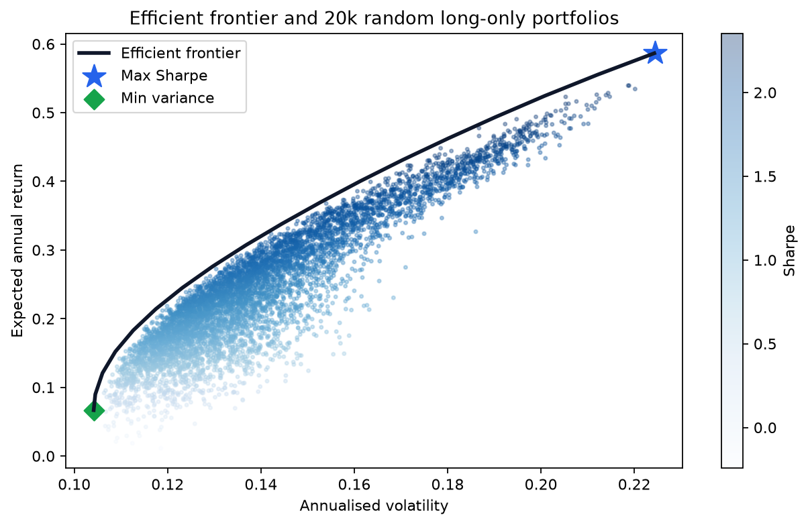

**Lambda selection (validation):**

|   lambda |   sharpe |   annual_return |   annual_volatility |   max_drawdown |
|---------:|---------:|----------------:|--------------------:|---------------:|
|     0    |   0.8726 |          0.2985 |              0.3083 |        -0.3112 |
|     0.25 |   0.7608 |          0.246  |              0.2936 |        -0.3409 |
|     0.5  |   0.7087 |          0.2194 |              0.2786 |        -0.3407 |
|     0.75 |   0.7106 |          0.2143 |              0.2678 |        -0.3417 |
|     1    |   0.488  |          0.1386 |              0.2468 |        -0.359  |

**Test-window backtest (net of 10 bps per side):**

| portfolio       |   total_return |   annual_return |   annual_volatility |   sharpe |   sortino |   max_drawdown |   calmar |   beta |   var95 |
|:----------------|---------------:|----------------:|--------------------:|---------:|----------:|---------------:|---------:|-------:|--------:|
| optimised_net   |         0.0538 |          0.0261 |              0.1835 |   0.0136 |    0.0135 |        -0.1701 |   0.1532 | 0.689  |  0.0189 |
| optimised_gross |         0.0789 |          0.038  |              0.1836 |   0.0768 |    0.0761 |        -0.1639 |   0.2319 | 0.6892 |  0.0188 |
| equal_weight    |         0.1674 |          0.0788 |              0.1862 |   0.2857 |    0.283  |        -0.2419 |   0.3259 | 0.9147 |  0.0186 |
| min_variance    |        -0.0105 |         -0.0052 |              0.1403 |  -0.2522 |   -0.2417 |        -0.1539 |  -0.0338 | 0.5344 |  0.0141 |
| gspc_buy_hold   |        -0.0254 |         -0.0125 |              0.1943 |  -0.1738 |   -0.1746 |        -0.2711 |  -0.0463 | 1      |  0.0191 |
| spy_buy_hold    |         0.0055 |          0.0027 |              0.1946 |  -0.0945 |   -0.094  |        -0.2622 |   0.0103 | 1.001  |  0.0195 |

The optimised portfolio's Sharpe is 0.014 with a block-bootstrap interval
`[-0.967, 1.484]`, PSR 0.630 and Deflated Sharpe 0.624 (using the lambda grid as the
trial set). **The PRD acceptance bar is not met: 0.014 is below 0.286.**
This is a credible negative result, not a coding failure: the 30% cap prevents concentration in
the one or two names that drove the 2022-2023 recovery, the forecast-based mu is noisy, and many
rebalances had to fall back to minimum variance when the risk-free rate exceeded all expected
returns. Equal-weight is a famously hard benchmark. The confidence intervals overlap, which is
the correct way to read the difference.

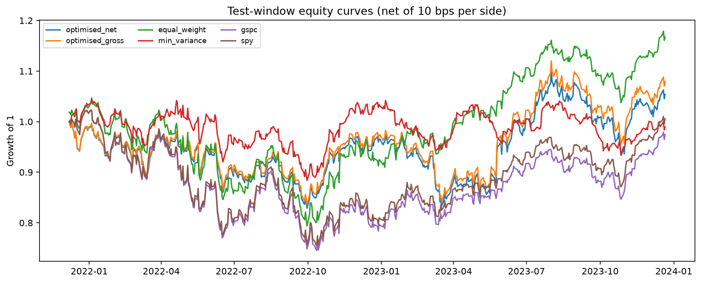

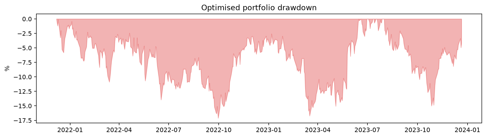

---

## 10. Recommendations and the ranking diagnostic

The composite is `w1 * forecast + w2 * sentiment - w3 * risk`, where the sub-signals are daily
cross-sectional z-scores: the model's h=5 forecast, 3-day sentiment momentum, and a risk score
combining volatility, 63-day drawdown and |beta-1|. Weights are tuned on validation by hit rate
(the share of BUY calls that beat the S&P 500 over the same five days, plus SELL calls that
underperform). Defaults are 0.5/0.2/0.3; the validation search chose
forecast 0.40, sentiment 0.20,
risk 0.40.

**Test-window hit rates:** BUY 56.4%, SELL
51.4%, overall 54.0%, versus an
always-buy rate of 51.4%. The engine is transparent and
every row shows its three sub-scores and a one-line reason. The test hit rate is
54.0% versus an always-buy rate of
51.4%; it is above the base rate on this window, but it is
one window and not a tested trading strategy.

**N3 cross-sectional rank-IC.** An XGBRanker (`rank:pairwise`, one group per date) is trained to
order the ten names by 5-day forward return. Test mean daily rank-IC is
0.0229 (t = 1.57, IC IR
0.068) with a top-minus-bottom spread of
0.0024 per five days. The sign is positive but the
cross-section is only ten names wide, so the evidence is weak; this is stated rather than
overclaimed.

**Latest signal table (last test session).** Every row shows its three sub-scores and a
one-line reason, so the user can see the "why" rather than a bare label.

| ticker   | decision   |   forecast_z |   sentiment_z |   risk_z |   composite | reason                                                   |
|:---------|:-----------|-------------:|--------------:|---------:|------------:|:---------------------------------------------------------|
| AAPL     | BUY        |       1.0249 |       -0.1184 |  -0.4658 |      0.5726 | BUY - forecast +1.02sd, sentiment -0.12sd, risk -0.47sd  |
| CAT      | HOLD       |      -0.6931 |        1.4085 |   0.4357 |     -0.1698 | HOLD - forecast -0.69sd, sentiment +1.41sd, risk +0.44sd |
| HD       | HOLD       |      -0.4099 |        0.5562 |  -0.2197 |      0.0351 | HOLD - forecast -0.41sd, sentiment +0.56sd, risk -0.22sd |
| JNJ      | HOLD       |      -0.0958 |        0.5562 |   0.0441 |      0.0553 | HOLD - forecast -0.10sd, sentiment +0.56sd, risk +0.04sd |
| JPM      | HOLD       |      -0.4005 |        0.5562 |  -0.3532 |      0.0923 | HOLD - forecast -0.40sd, sentiment +0.56sd, risk -0.35sd |
| KO       | HOLD       |       0.8075 |        0.2104 |  -0.1492 |      0.4247 | HOLD - forecast +0.81sd, sentiment +0.21sd, risk -0.15sd |
| MSFT     | SELL       |      -1.8757 |       -0.6058 |  -0.3668 |     -0.7247 | SELL - forecast -1.88sd, sentiment -0.61sd, risk -0.37sd |
| NVDA     | HOLD       |       1.7199 |       -1.0664 |   1.0741 |      0.0451 | HOLD - forecast +1.72sd, sentiment -1.07sd, risk +1.07sd |
| PG       | HOLD       |      -0.0454 |        0.5562 |   0.4032 |     -0.0682 | HOLD - forecast -0.05sd, sentiment +0.56sd, risk +0.40sd |
| XOM      | HOLD       |      -0.0318 |       -2.0533 |  -0.4024 |     -0.2624 | HOLD - forecast -0.03sd, sentiment -2.05sd, risk -0.40sd |

---

## 11. Limitations and failure analysis

- **One test window.** 2021-11 to 2023-12 is a single regime (inflation shock, then a
  mega-cap-led recovery). A different window could reorder the models. The walk-forward refit is
  a robustness check, not a second independent test. The 2022-2023 part of this window was also
  observed in the earlier 2015-2023 study that motivated the extension; only 2021-11 to 2022-10
  is new, so the comparison with the old run is exploratory, not a pristine holdout.
- **A refit/ensemble experiment did not help.** On the earlier 2015-2023 window we refit the
  selected models on train+validation and built a validation-selected ML+DL ensemble. It did not
  improve test MAE at either horizon, so it was not adopted; the code and results remain in git
  history. The current results use the pre-registered train-only protocol.
- **Survivorship bias.** The ten names are today's winners. Equal-weight carries the same bias,
  which is why it is the fair comparison; a historical index membership list would be better.
- **News coverage.** Four tickers have no headlines after 2020 and the others are sparse before
  2018. The sentiment ablation is therefore not a clean 10-name experiment; per-ticker coverage
  is reported in `reports/news_coverage.csv`.
- **One sentiment labeller.** One person labelled the 200 headlines using the rules in `scripts/label_sentiment.py`, and the optional 50-row relabel was not done, so label noise is unmeasured. The intervals cover sampling uncertainty only, and accuracy means agreement with this labeller under those rules.
- **Multiple testing.** Many configurations were tried; the count is logged in
  `reports/experiments.csv`, and the Deflated Sharpe ratio uses the trial set. The reported
  significance is not adjusted for every discretionary choice.
- **Assumptions.** Transaction costs are a flat 10 bps per side; there is no market impact,
  borrow cost or taxes. The portfolio is long-only. The save-rate in the campaign layer (the
  plan's P3 extra) is an assumption, not measured uplift.
- **No live mode.** The research window is the evidence; the dashboard does not mix post-2023
  data into evaluated results.

---

## 12. Reproducibility and deliverables

**PRD Section 19 checklist.**

| Deliverable | Status | Where |
|---|---|---|
| Git repo with the layered structure and pinned requirements | Done | `src/`, `requirements.txt`, `.github/workflows/ci.yml` |
| Deterministic ingestion + cleaning and a data-quality report | Done | `src/ingest.py`, `src/clean.py`, `reports/data_quality.md` |
| Feature and sequence modules with no look-ahead (tested) | Done | `src/features.py`, `tests/test_features.py` |
| EDA notebook with captioned, decision-linked findings | Done | `notebooks/01_eda.ipynb` (executed) |
| From-scratch financial maths checked against libraries, GD = OLS | Done | `src/finmath.py`, `tests/test_finmath.py` |
| Four tuned ML models and four DL models, populated 8-model table | Done | `src/models_ml.py`, `src/models_dl.py`, `reports/model_comparison.csv` |
| Sentiment pipeline + FinBERT validation + with/without result | Done | `src/sentiment.py`, `reports/sentiment_ablation.csv`, `reports/sentiment_labelling.csv` |
| Efficient frontier, max-Sharpe weights, Monte Carlo, baseline backtest | Done | `src/portfolio.py`, `reports/efficient_frontier.parquet`, `reports/portfolio_backtest.csv` |
| Transparent recommendation and rebalancing engine | Done | `src/recommend.py`, `reports/recommendations_latest.csv` |
| Streamlit dashboard with all seven panels and the disclaimer | Done | `dashboard/app.py` |
| 10-15 page report with honest failure analysis | This document | `reports/final_report.pdf` |
| README with one-command rebuild | Done | `README.md` |

- One command rebuilds data: `python -m src.pipeline data [--offline]`.
- One command retrains and evaluates: `python -m src.pipeline train`.
- The dashboard: `streamlit run dashboard/app.py` (reads cached outputs, never retrains on load).
- The report: `python scripts/make_report.py`.
- Seeds are fixed; `config.yaml` holds the universe, dates, split ratios, horizons, windows,
  costs, caps and recommendation weights; `requirements.txt` is pinned.
- Tests cover leakage, cleaning, macro lags, session alignment, financial maths, evaluation,
  portfolio constraints and the recommendation rules. CI runs ruff and pytest.
- The data-quality report is `reports/data_quality.md`; the model cards are in
  `models/model_cards/`; the experiment log is `reports/experiments.csv`.

---

## 13. Future work

The PRD's future-work list is the roadmap: Black-Litterman blending of model views with market
equilibrium, HRP and CVaR portfolios, a Temporal Fusion Transformer or other attention-based
multivariate model, reinforcement-learning allocation, quantile/DeepAR prediction intervals,
alternative data (earnings-call transcripts, options-implied volatility), real-time ingestion and
automated retraining, transaction-cost/slippage modelling, MLflow experiment tracking and Docker/
CI deployment. The ranking objective and walk-forward rigour are already implemented here (N3, N4);
the remaining items are deliberately left out of the four-week baseline.

---

## Glossary

| Term | Meaning |
|---|---|
| Log return | `ln(P_t / P_(t-1))`; time-additive and the modelling target. |
| Adjusted close | Close adjusted for splits and dividends; mandatory for returns. |
| IC | Information coefficient, the Spearman rank correlation between forecasts and outcomes. |
| Rank-IC | Cross-sectional IC computed per date across the ten names, then averaged. |
| Embargo | Trading sessions dropped at a split boundary so a target cannot cross it. |
| PSR | Probabilistic Sharpe ratio: probability the true Sharpe exceeds a benchmark. |
| DSR | Deflated Sharpe ratio: PSR adjusted for the number of configurations tried. |
| VaR95 | The 5th-percentile daily loss, reported as a positive number. |
| Max drawdown | Worst peak-to-trough loss of the equity curve. |
| Ledoit-Wolf | Shrinkage estimator that stabilises the covariance matrix. |
| Conformal band | Prediction interval built from validation residuals. |

---

*Educational research and decision-support prototype. Nothing in this report is financial advice.*
